# ARCHITECTURE.md: quan hệ App – Camera – Server

Bản nháp S1 v0.3. Các sơ đồ dưới đây vẽ bằng mermaid; ảnh PNG tương ứng nằm trong `diagrams/`.
Đi kèm `PROTOCOL.md` (chi tiết thông điệp) và `openapi.yaml`.

## 0. Quyết định kiến trúc đang áp dụng

| # | Quyết định | Nguồn |
|---|---|---|
| A1 | Toàn bộ server và hạ tầng **chỉ viết bằng Go** | Chỉ đạo |
| A2 | **Ba loại server tách rời**: **Server API**, **Server MQTT**, **Server Stream** (TURN). Mỗi loại chạy được trên máy riêng và mỗi loại **có thể là một cụm (cluster)** | Chỉ đạo |
| A3 | Ở bản PoC cả ba chạy chung một máy dưới dạng ba tiến trình, vẫn tách ranh giới như khi chạy riêng | Thiết kế |
| A4 | Bám sát thiết kế Tuya cho vòng đời, MQTT và định dạng thông điệp; media dùng WebRTC chuẩn | Chỉ đạo |

Tên ba chương trình Go (đề xuất): `cam-api`, `cam-mq`, `cam-stream`.

> Chưa xác minh: thư viện Go dự kiến cho `cam-mq` là `mochi-mqtt/server` (bản mới nhất trên proxy ghi ngày 2025-03-01, lâu hơn các thư viện khác) và cho `cam-stream` là `pion/turn` (bản 2026-01). Theo hiểu biết của mình `mochi-mqtt` **không có cụm sẵn**, nên thiết kế dưới đây chia broker theo `devid` (mục 3) để không cần cụm broker. Cần kiểm lại khi cài ở S3.

---

## 1. Bức tranh tổng thể

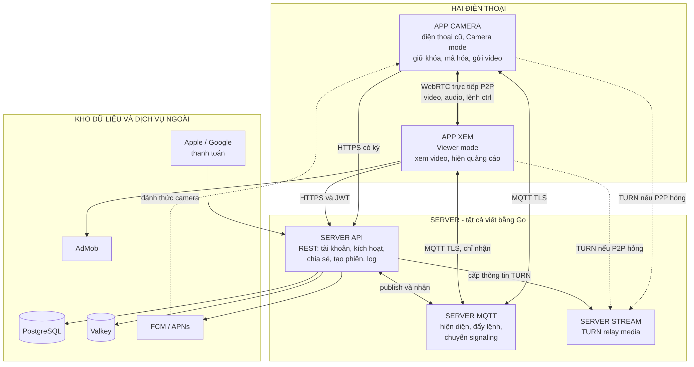

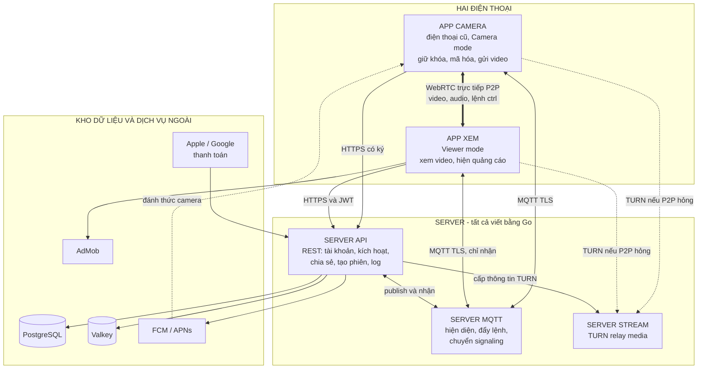

**Đọc sơ đồ:** có ba "đường" tách biệt.
1. **Đường điều khiển (REST)** đi tới Server API: tài khoản, kích hoạt, tạo phiên, chia sẻ, log.
2. **Đường đẩy tin (MQTT)** đi qua Server MQTT: lệnh xuống camera, hiện diện, `answer`/`candidate` giữa hai điện thoại. Người dùng chỉ **nhận** trên MQTT, không ghi.
3. **Đường media (WebRTC)** đi **thẳng giữa hai điện thoại**. Server Stream chỉ chuyển gói đã mã hóa khi đi thẳng thất bại. Không server nào thấy nội dung video hay khóa.

### Ai nói chuyện với ai

| Từ | Đến | Giao thức | Mục đích |
|---|---|---|---|
| App camera | Server API | HTTPS, yêu cầu có ký (`seckey`) | Kích hoạt, báo thông tin khi khởi động, báo cáo phiên, trả log |
| App camera | Server MQTT | MQTT qua TLS (8883, dự phòng 443) | Nhận lệnh và signaling, báo DP, báo hiện diện |
| App xem | Server API | HTTPS, JWT | Đăng nhập, danh sách camera, tạo phiên, gửi `offer`/`candidate`, chia sẻ |
| App xem | Server MQTT | MQTT qua TLS | **Chỉ nhận**: `answer`, `candidate`, `disconnect`, DP |
| Server API | Server MQTT | MQTT (client) | Ghi lệnh/signaling vào chủ đề của camera và của người xem; nhận thông điệp camera gửi lên và hiện diện |
| Server API | Server Stream | Bí mật chung (TURN REST) | Cấp thông tin TURN có hạn cho từng phiên |
| Camera ↔ App xem | Nhau | WebRTC (DTLS-SRTP, DataChannel) | Video, audio, lệnh `ctrl` |
| Camera, App xem | Server Stream | TURN (UDP 3478, TCP/TLS 443) | Chỉ khi đi thẳng thất bại |
| Server API | FCM / APNs | HTTPS | Đánh thức camera ở nền |
| Apple / Google | Server API | Thông báo máy chủ | Cập nhật gói thuê bao |

---

## 2. Từng thành phần giữ gì

| Thành phần | Giữ dữ liệu gì | Không bao giờ giữ |
|---|---|---|
| **App camera** | `uuid`, `authkey`, `devid`, `seckey`, `localkey` trong Keystore/Keychain | Khóa người dùng khác |
| **App xem** | Token đăng nhập, cấu hình MQTT có hạn | `seckey` của camera |
| **Server API** | Tài khoản, camera, chia sẻ, gói, lịch sử yêu cầu log, **băm** của `authkey` và lời mời; `seckey` mã hóa bằng KMS | Nội dung media, khóa DTLS |
| **Server MQTT** | Kết nối đang mở, hàng đợi QoS 1 ngắn hạn, thông điệp retained của hiện diện | Tài khoản, quyền (hỏi Server API khi kiểm đăng nhập) |
| **Server Stream** | Allocation TURN đang chạy (trong bộ nhớ) | Mọi thứ khác; không biết ai là ai ngoài `sessionid` trong tên đăng nhập TURN |
| **PostgreSQL** | Dữ liệu bền: tài khoản, camera, chia sẻ, gói | |
| **Valkey** | Phiên đang chạy, hiện diện nhanh, giới hạn tốc độ | |

---

## 3. Chạy thành cụm (cluster)

Ba loại server **độc lập**: có thể mở rộng, thay thế hay đặt ở vùng khác nhau mà không đụng loại kia.

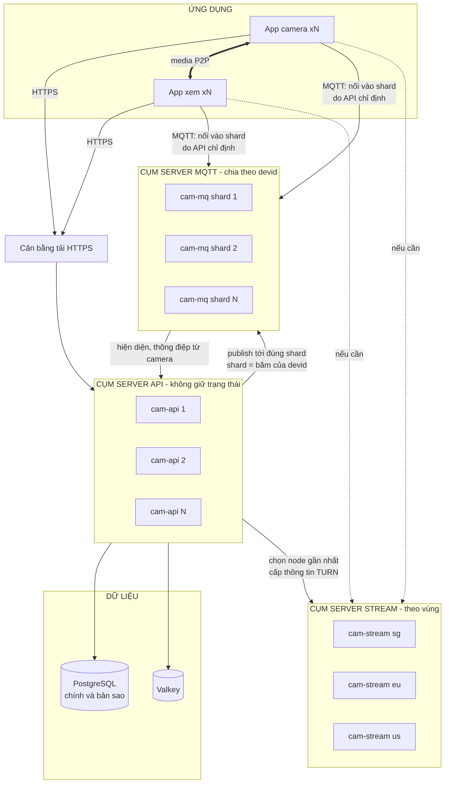

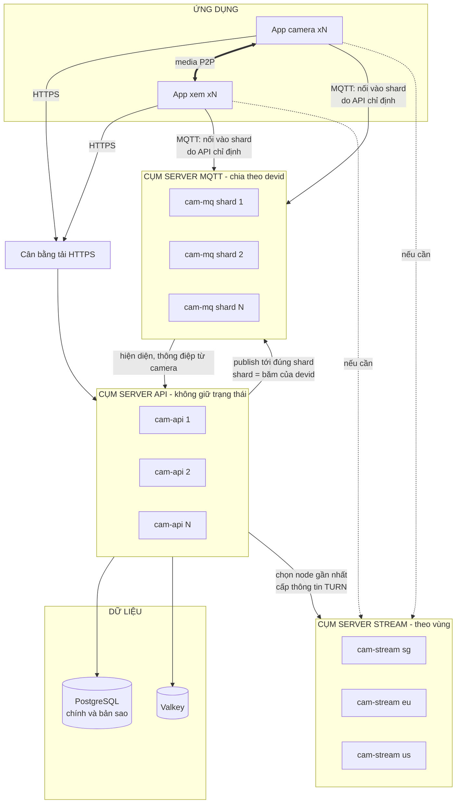

### 3.1 Server API: cụm không giữ trạng thái
- Nhiều bản `cam-api` sau cân bằng tải. Mọi trạng thái bền nằm trong PostgreSQL, trạng thái nóng trong Valkey. Bản nào cũng xử lý được mọi yêu cầu.
- Mỗi bản `cam-api` là **client MQTT** của mọi shard (để ghi vào chủ đề của camera bất kỳ).

### 3.2 Server MQTT: chia shard theo `devid`
Vấn đề của cụm: camera chỉ nối vào **một** node broker. Muốn gửi `offer` tới camera, Server API phải ghi **đúng node đang giữ kết nối đó**.

Cách giải (không cần broker có cụm sẵn):
- Mỗi thiết bị có một **shard cố định** `shard = consistent_hash(devid)` trên danh sách node broker đang sống; lưu trong CSDL (`device.mq_node`).
- Địa chỉ broker **không** cố định trong app. Nó đến từ API: camera nhận `mqtt_url` trong `PUT /devices/{devid}/info` (giống `mqttsSelfUrl` của Tuya); app xem nhận `url` trong `POST /mqtt/access-config` (shard của `uid`).
- Mất một node: thiết bị nối lại thất bại → hỏi API lấy `mqtt_url` mới (shard được gán lại) → nối vào node khác. Broker mới có hàng đợi trống, nên thông điệp đang bay có thể mất; phiên đang bay hết hạn theo thời hạn pha (PROTOCOL.md 7.2).
- Nếu sau này chọn broker có cụm sẵn thì **bỏ phần shard**, mọi node nhận mọi chủ đề.

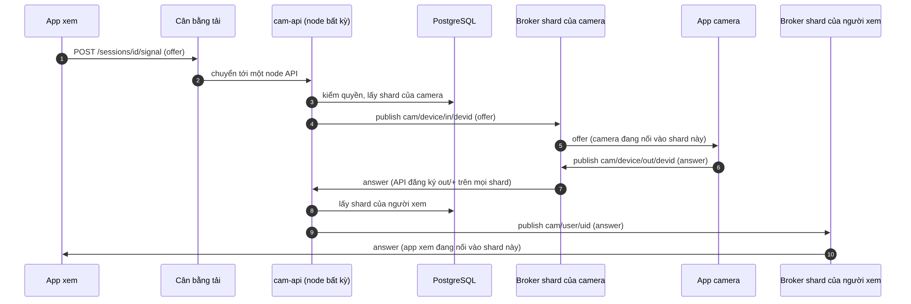

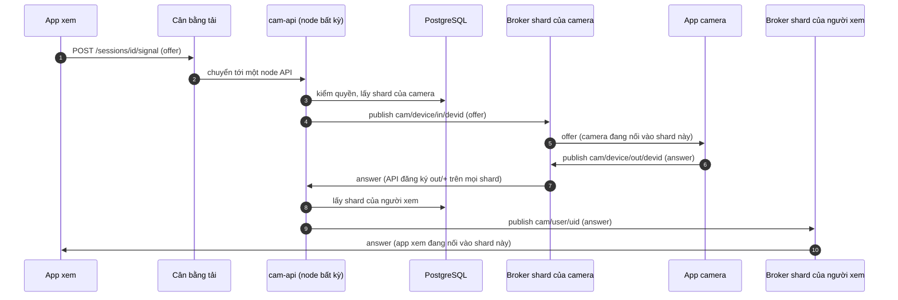

### 3.3 Server Stream: node độc lập, theo vùng
- Mỗi node `cam-stream` chạy TURN **không cần biết các node khác**. Tất cả dùng chung một bí mật HMAC với `cam-api` (TURN REST), nên thông tin đăng nhập do `cam-api` tạo hợp lệ trên mọi node.
- `cam-api` chọn **vài node gần cả hai đầu** (theo vùng và tải) rồi đưa vào `token`, `udp_token`, `tcp_token` của phiên. Mở rộng = thêm node và đăng ký vào danh sách; không phải đồng bộ trạng thái.
- Tên "Server Stream" để dành chỗ cho loại server media khác về sau (ví dụ SFU) mà không đổi sơ đồ.

---

## 4. Chủ đề MQTT và quyền

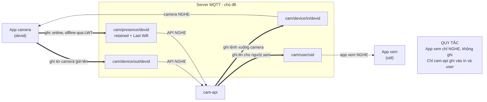

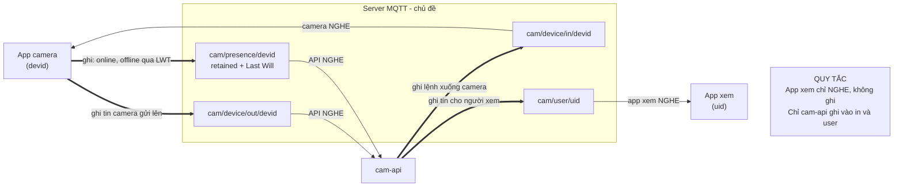

| Chủ đề | Thông điệp trong đó |
|---|---|
| `cam/device/in/{devid}` | `offer`, `candidate`, `disconnect`, `dp.set`, `reset`, `log.request`, `error` |
| `cam/device/out/{devid}` | `answer`, `candidate`, `disconnect`, `dp.report`, `error` |
| `cam/presence/{devid}` | `{"v":1,"online":true/false}` (retained, Last Will) |
| `cam/user/{uid}` | `answer`, `candidate`, `disconnect`, `dp.report`, `log.request`, `error` |

Quy tắc ACL: thiết bị chỉ nghe `in/<devid của mình>`, chỉ ghi `out` và `presence` của mình. Người dùng chỉ nghe `user/<uid của mình>` và **không ghi**. Chỉ `cam-api` ghi vào `in/*` và `user/*`.

---

## 5. Từ camera mới đến lúc xem được

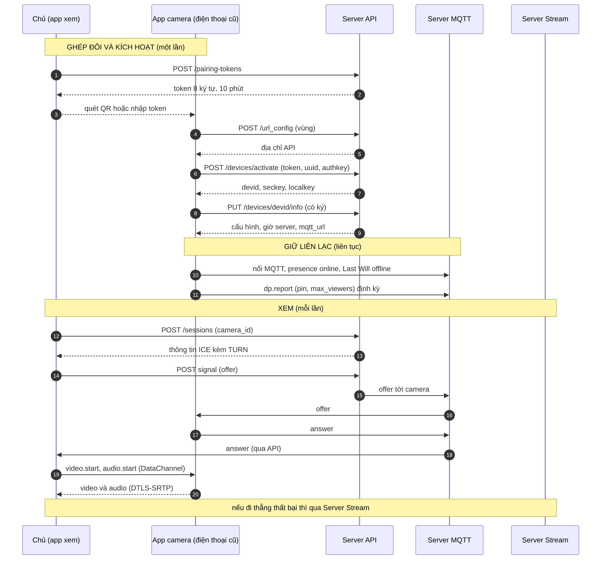

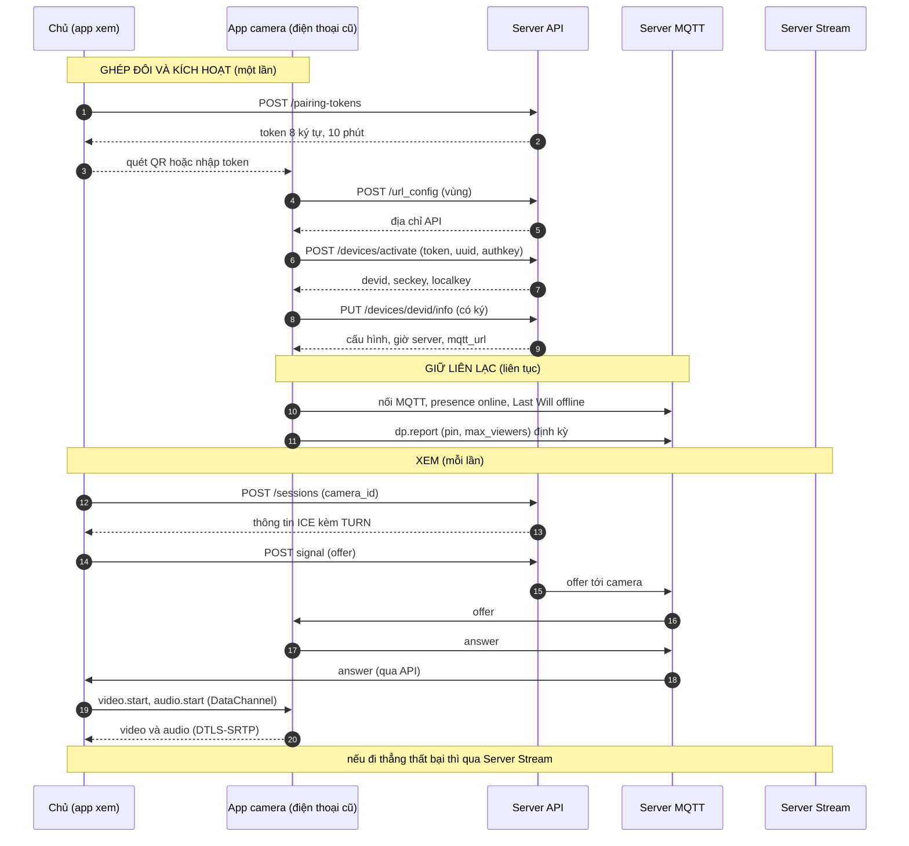

---

## 6. Hai đường đi của media

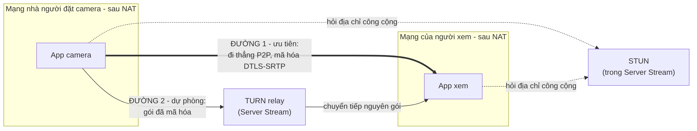

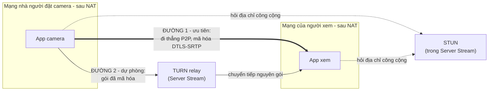

- Hai bên thử đường 1 trước (ICE). Không được trong 20 giây thì dùng đường 2.
- Ở cả hai đường, **khóa media sinh giữa hai điện thoại** (DTLS), nên Server Stream chỉ thấy gói mã hóa.
- Mạng chặn UDP: TURN qua TCP/TLS cổng 443 (`tcp_token`).

---

## 7. Cách triển khai

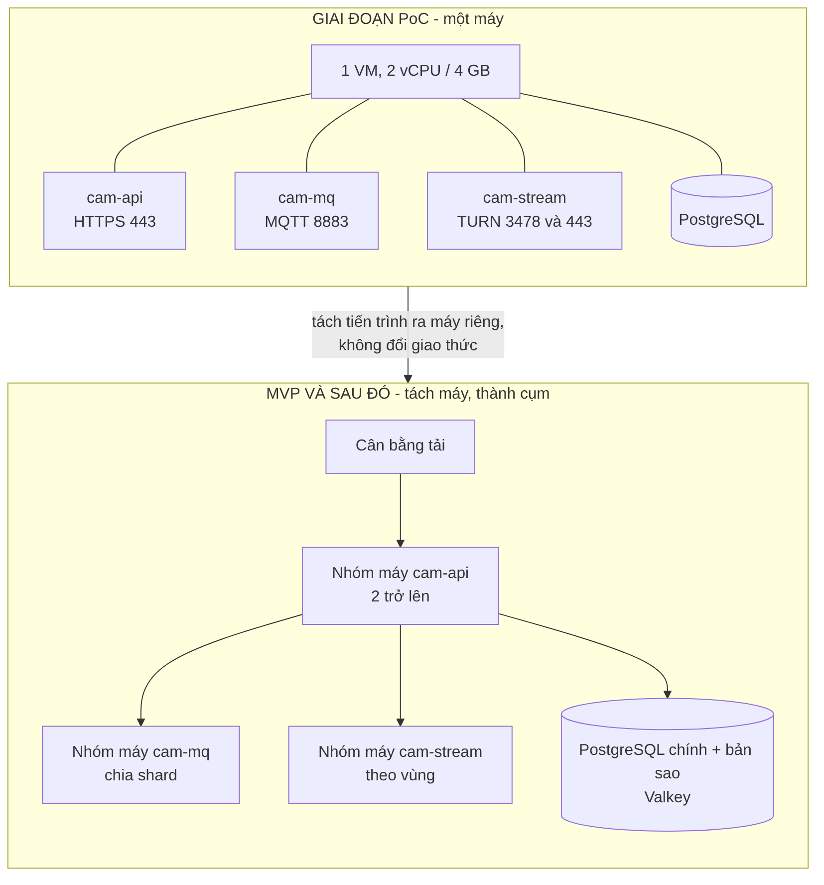

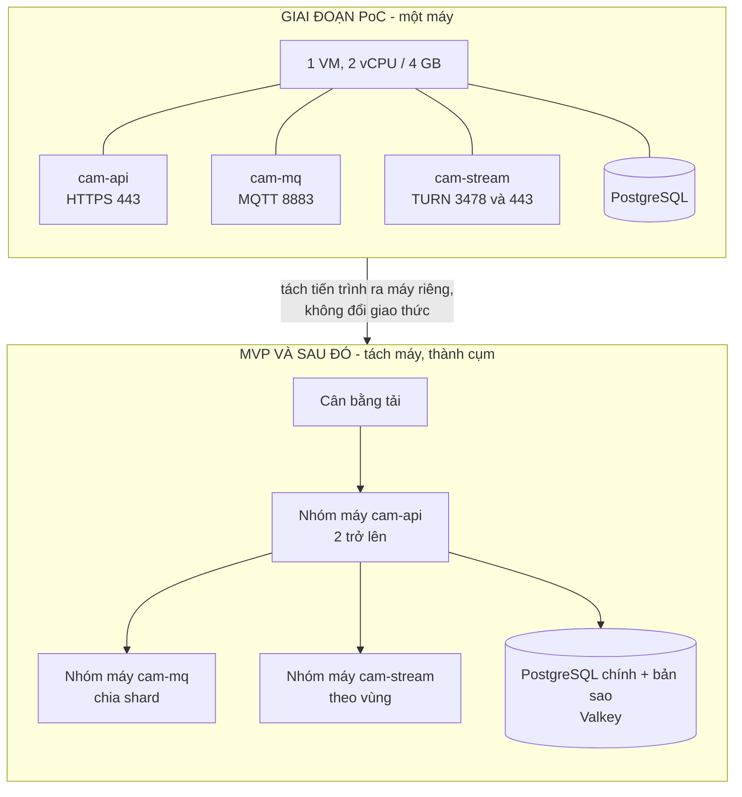

- Ba chương trình Go **tách ranh giới ngay từ PoC**: chúng nói với nhau bằng đúng các giao thức ở mục 1 dù cùng một máy, nên chuyển sang cụm không đổi giao thức.
- Chứng chỉ TLS: dùng thư viện ACME của Go (`autocert`), không cần chương trình ngoài.
- PostgreSQL và Valkey là kho dữ liệu dùng sẵn, không phải mã do dự án viết.

---

## 8. Việc còn mở về kiến trúc

| # | Vấn đề | Cách giải |
|---|---|---|
| 1 | `mochi-mqtt` chưa xác minh về cụm, bảo trì (bản mới nhất 2025-03-01), tải thực tế | Thử ở S3; phương án dự phòng: viết broker tối giản bằng Go hoặc chấp nhận một broker ngoài Go (cần bạn quyết định vì lệch chỉ đạo Go-only) |
| 2 | `pion/turn` chưa đo tải so với coturn | Đo ở S7; coturn là phương án dự phòng (viết bằng C, cũng lệch Go-only) |
| 3 | `cam-api` đăng ký `out/+` trên **mọi** shard: số kết nối API × shard tăng nhanh | Đo ở S3; có thể dùng đăng ký chia sẻ của MQTT 5 nếu broker hỗ trợ (chưa xác minh) |
| 4 | Shard bị lệch tải hoặc mất node: cách gán lại | Băm nhất quán + lưu `mq_node` trong CSDL; chốt ở S3 |
| 5 | Hiện diện: lấy từ `presence` retained, hay đồng bộ vào Valkey | Chốt ở S3 |
| 6 | Cần vẽ thêm sơ đồ cho luồng chia sẻ, thanh toán, log theo yêu cầu | Log đã có ở `PROTOCOL.md` mục 10; chia sẻ và thanh toán vẽ ở S11, S14 |
