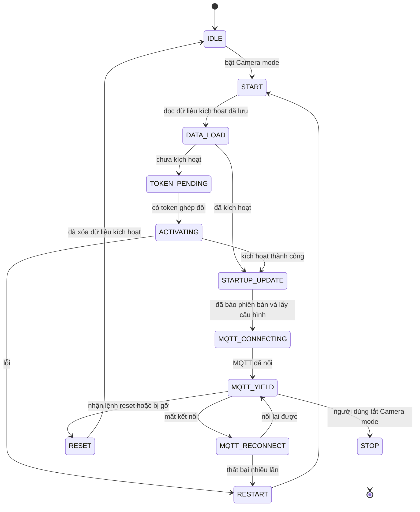
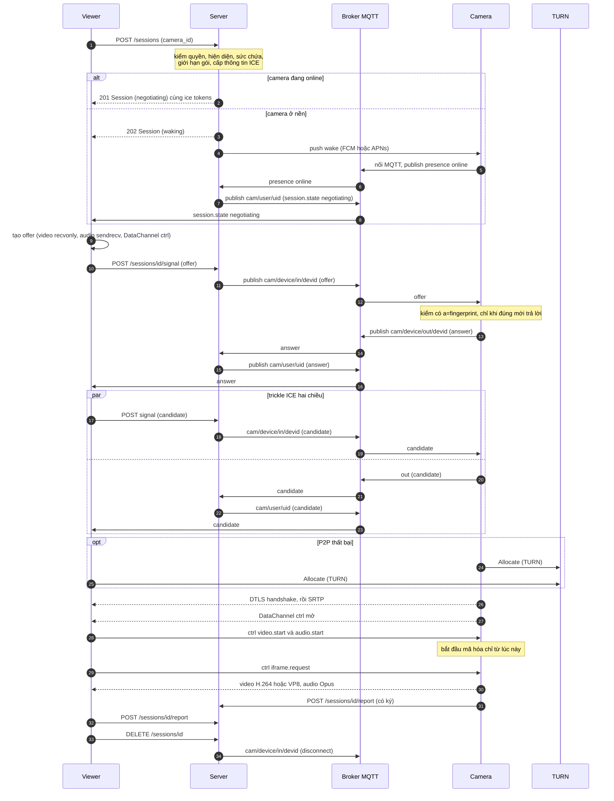
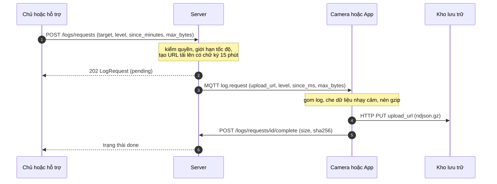

# PROTOCOL.md: giao thức Camera + Viewer (bản nháp S1, v0.2)

Trạng thái: **DRAFT 0.2**, chưa có cài đặt nào. Đi kèm `openapi.yaml` (HTTP, thông điệp MQTT, thông điệp DataChannel) và `ARCHITECTURE.md` (sơ đồ quan hệ App – Camera – Server, cụm, định tuyến).
Bản 0.2 **viết lại để bám sát luồng thiết bị ↔ cloud của Tuya** (đã đọc mã nguồn mở của họ). Mọi con số là *đề xuất ban đầu*, sẽ chỉnh bằng số đo thật ở S7.

Từ khóa **PHẢI**, **NÊN**, **CÓ THỂ** theo nghĩa của RFC 2119.

---

## 1. Nguyên tắc và mức bám sát Tuya

Hai chuẩn tham chiếu trong thiết kế này: (1) cách Tuya tổ chức vòng đời thiết bị, signaling và lệnh, (2) WebRTC chuẩn cho phần media.

### 1.1 Giữ giống Tuya

| Hạng mục | Tuya | Giao thức này |
|---|---|---|
| Máy trạng thái thiết bị | `IDLE → START → DATA_LOAD → TOKEN_PENDING → ACTIVATING → STARTUP_UPDATE → MQTT_CONNECTING → MQTT_YIELD`, nhánh `RECONNECT/RESTART/RESET/STOP` | Giống (mục 4) |
| Danh tính ban đầu | `UUID` + `AUTHKEY` | `uuid` + `authkey` (mục 3.2) |
| Ghép đôi | Token do cloud tạo, **tối đa 8 ký tự, sống 10 phút** | Giống (`POST /pairing-tokens`) |
| Kích hoạt | Gửi token + UUID + AUTHKEY, nhận `devid`, `seckey`, `localkey` | Giống (`POST /devices/activate`) |
| Tìm địa chỉ theo vùng | Hỏi dịch vụ `url_config` | Giống (`POST /url_config`) |
| Kênh điều khiển | **MQTT**, chủ đề riêng mỗi thiết bị `in/<devid>` và `out/<devid>`, QoS 1, keepalive | Giống (mục 6) |
| Báo trạng thái | Bản đồ Data Point `{"dps":{…},"t":…}` | Giống (mục 9) |
| Khởi động | Báo phiên bản, lấy cấu hình động, đồng bộ giờ | Giống (`PUT /devices/{devid}/info`) |
| Reset | 5 loại: factory, remote/local unactive, remote factory, data factory | Giống (`ResetType`) |
| Signaling P2P | JSON `header` + `msg`; `header`: `from`, `to`, `sessionid`, `type`, `trace_id`, `security_level` | Giống (mục 6.3) |
| Loại thông điệp | `offer`, `answer`, `candidate`, đóng phiên, lỗi | Giống |
| **Ai tạo offer** | App tạo offer, thiết bị trả answer | Giống: **viewer tạo offer, camera trả answer** |
| Thông tin ICE | `token`, `udp_token`, `tcp_token` kèm trong offer | Giống (mục 7.4) |
| Kênh dữ liệu | 3 kênh: 0 = lệnh, 1 = video, 2 = audio | Lệnh = DataChannel `ctrl`; video, audio = hai track WebRTC |
| Lệnh phiên xem | Bắt đầu/dừng video, audio, loa; **xin khung I**; **đổi bitrate** | Giống (mục 8) |
| Lấy log theo yêu cầu | Cloud lấy được log của thiết bị | Giống (mục 10) |
| Hết hạn thông tin kết nối của app | Cấu hình MQTT có hạn, hết hạn thì xin mới | Giống (`POST /mqtt/access-config`) |
| Yêu cầu có ký | Mọi lời gọi thiết bị đều ký, có `t` | Giống (`deviceSign`, mục 3.3) |

### 1.2 Khác Tuya, và lý do

| # | Khác biệt | Lý do | Ghi chú |
|---|---|---|---|
| D1 | **Bảo mật media: DTLS-SRTP chuẩn của WebRTC**, không dùng "khóa AES nằm trong SDP + HMAC-SHA1 trên KCP" | Trong mã Tuya, khóa phiên đi trong SDP qua cloud nên cloud đọc được media. DTLS-SRTP sinh khóa giữa hai đầu, server không thấy. SDP của Tuya cũng đã khai báo `UDP/TLS/RTP/SAVPF` và `a=fingerprint`, tức ý đồ vốn là WebRTC | **Đã được người phụ trách xác nhận (2026-11-05): dùng WebRTC chuẩn.** Không tự cài KCP và AES; dùng `flutter_webrtc` |
| D2 | Không có lớp mã hóa AES-ECB và CRC32 trên thông điệp MQTT | ECB là chế độ yếu. TLS đã bảo vệ kênh | |
| D3 | Không dùng KCP | WebRTC có SCTP và SRTP sẵn | |
| D4 | Nhiều viewer một camera | Yêu cầu sản phẩm (Free 1 người, Plan 10 người). Mã Tuya chỉ cho một phiên | `max_viewers` do camera báo (mục 9) |
| D5 | Camera là điện thoại | Không có bước nối router, không có khóa nhà máy: `uuid` và `authkey` do app sinh khi cài | |
| D6 | Signaling của **viewer** đi qua REST rồi server ghi vào MQTT | Giống cách app Tuya gửi qua cloud; ACL MQTT đơn giản: người dùng không được ghi | |
| D7 | Không chép các trường `moto_id`, `is_pre`, `p2p_skill`, `path`, `sub_dev_id` | Chưa rõ ngữ nghĩa trong mã Tuya | Thêm sau khi cần |

### 1.3 Vì sao MQTT (Tuya chọn) chứ không phải WebSocket (bản 0.1 của mình chọn)

Bản 0.1 dùng WebSocket vì quen, dễ viết bằng Go và ít thành phần hơn. Lý do Tuya chọn MQTT, theo những gì thấy trong mã (chủ đề riêng mỗi thiết bị, QoS 1, keepalive, chế độ ngủ chỉ giữ nhịp tim 30–120 giây, chủ đề đánh thức):

| Tiêu chí | MQTT | WebSocket tự định nghĩa |
|---|---|---|
| Thiết bị nhỏ, ít điện | Giao thức rất nhẹ, tiêu đề vài byte, thư viện nhỏ cho chip yếu | Nặng hơn, cần tự thiết kế thông điệp |
| Hiện diện online/offline | Có sẵn: **retained message + Last Will (LWT)** | Phải tự làm bằng heartbeat và TTL |
| Giao tin tin cậy | **QoS 0/1/2**, hàng đợi cho client mất kết nối ngắn (phiên liên tục) | Tự làm xác nhận và gửi lại |
| Phân quyền | ACL theo chủ đề (thiết bị chỉ nghe chủ đề của mình) | Tự cài trong server |
| Mở rộng | Broker có sẵn, hàng trăm nghìn kết nối mỗi node (số thường được công bố, chưa đo ở đây) | Tự viết, tự đo |
| Chuẩn hóa | OASIS, nhiều thư viện | Chỉ là kênh truyền |

Chi phí khi dùng MQTT: thêm một thành phần (Server MQTT viết bằng Go, dự kiến dựa trên thư viện `mochi-mqtt`, xác thực và ACL qua hàm móc (hook) bằng Go), phải tích hợp xác thực broker với `cam-api`, và một số mạng chặn cổng 8883 nên dự phòng **MQTT qua WebSocket TLS cổng 443**. Điện thoại không phải thiết bị hạn chế như chip camera, nên lợi ích "nhẹ" ít quan trọng; lợi ích còn lại là hiện diện LWT, QoS và ACL. Vì chỉ đạo là bám sát Tuya nên bản 0.2 dùng MQTT.

---

## 2. Vai trò

| Vai | Mô tả |
|---|---|
| **Camera** | App ở Camera mode. Giữ kết nối MQTT, trả answer, gửi media, phục vụ nhiều viewer tới `max_viewers` |
| **Viewer** | App ở Viewer mode (chủ hoặc người được chia sẻ). Xin phiên, tạo offer, nhận media |
| **Server API** (`cam-api`) | REST. Lưu tài khoản, quyền, gói. Là client MQTT của Server MQTT để ghi lệnh và signaling. Không chạm media |
| **Server MQTT** (`cam-mq`) | Broker MQTT: hiện diện (Last Will), đẩy lệnh, chuyển signaling. Chia **shard theo `devid`** khi chạy cụm |
| **Server Stream** (`cam-stream`) | TURN. Chỉ chuyển gói đã mã hóa khi P2P thất bại. Các node độc lập, theo vùng |

Ba loại server **tách rời** (có thể trên máy khác nhau) và mỗi loại **có thể là một cụm**. **Toàn bộ viết bằng Go.** Xem `ARCHITECTURE.md`.

Một điện thoại có thể vừa là Camera vừa là Viewer; hai vai dùng **hai client MQTT riêng**.

---

## 3. Danh tính và xác thực

### 3.1 Người dùng
Email/mật khẩu (`/auth/register`, `/auth/login`). **Access token** JWT **HS256** sống 15 phút (JWT guard có sẵn của Goravel, chỉ ký được HS256). Dùng HS256 được vì chỉ `cam-api` ký và kiểm token; `cam-mq` cũng hỏi `cam-api`, không bên thứ ba nào cần khóa công khai. Bí mật (`JWT_SECRET`) ngẫu nhiên ≥ 32 byte, giống nhau trên mọi node `cam-api`, nằm trong kho bí mật, không nằm trong mã. **Refresh token** là chuỗi ngẫu nhiên (không phải JWT), server chỉ lưu băm, sống 30 ngày, xoay vòng, dùng lại token cũ thì cả chuỗi bị thu hồi. Phần xoay vòng dự án tự viết, vì cơ chế làm mới của Goravel không có phát hiện dùng lại.

### 3.2 Thiết bị (Camera)
Theo Tuya:
- **`uuid`** (UUID v4) và **`authkey`** (32 ký tự ngẫu nhiên) do app sinh một lần khi bật Camera mode và cất trong Android Keystore hoặc iOS Keychain. Server chỉ lưu băm SHA-256 của `authkey`.
- **Kích hoạt** (`POST /devices/activate`): gửi `token` ghép đôi + `uuid` + `authkey` + `product_key`, nhận **`devid`, `seckey` (16 ký tự), `localkey` (16 ký tự)**. Thiết bị cất cả ba trong kho khóa. `seckey` dùng để ký REST và sinh mật khẩu MQTT. `localkey` dành cho đường LAN sau này, v1 chưa dùng.
- **Mật khẩu MQTT** của thiết bị (không cần gọi API): `client_id = username = devid`, `password = "<ts>:" + hex(HMAC-SHA256(seckey, devid + ":" + ts))` với `ts` là giây Unix. Server MQTT kiểm bằng hàm móc gọi tới `cam-api`, chấp nhận khi `ts` lệch tối đa 300 giây. *Đây là công thức của dự án; thuật toán thật của Tuya mình chưa xác minh.*

### 3.3 Yêu cầu REST của thiết bị có ký
Header `X-Devid`, `X-Time` (ms), `X-Sign = hex(HMAC-SHA256(seckey, METHOD + "\n" + PATH + "\n" + X-Time + "\n" + hex(SHA256(body))))`. Server từ chối khi giờ lệch quá 5 phút hoặc chữ ký sai (`401 bad_signature`). Body của mọi yêu cầu thiết bị có trường `t` (ms), giống Tuya.

### 3.4 Người dùng trên MQTT
App xin `POST /mqtt/access-config` nhận `url`, `client_id`, `username`, `password`, `expire_time` (mặc định 2 giờ) và chủ đề `cam/user/{uid}`.
**Khi sắp hết hạn: bỏ hẳn client cũ, xin cấu hình mới, nối bằng client mới.** Không để thư viện tự nối lại bằng thông tin cũ (Tuya từng gặp lỗi "bão kết nối lại" đúng vì việc này).

---

## 4. Máy trạng thái của camera (theo Tuya)



Trạng thái hiển thị cho người dùng (theo `tuya_client_status_t`): `chưa kích hoạt` → `chờ ghép đôi` → `đang kết nối` → `đã nối MQTT`. Hai trạng thái liên quan router của Tuya không có ở điện thoại.
Trạng thái phía server suy ra từ hiện diện: `offline`, `online`, `in_session`, `revoked`.

---

## 5. Vòng đời thiết bị theo giai đoạn

### Giai đoạn 1 — Danh tính
Lần đầu bật Camera mode, sinh `uuid` và `authkey`, cất vào kho khóa. Mất app thì mất danh tính; camera cũ trên server ở trạng thái `offline` cho tới khi chủ gỡ.

### Giai đoạn 2 — Ghép đôi
Chủ gọi `POST /pairing-tokens` nhận `token` (**đúng 8 ký tự** từ bảng `A-Z2-9`, khoảng 41 bit; **sống 10 phút, dùng một lần**) và `qr_payload`. Điện thoại camera quét QR hoặc nhập tay. Nếu camera chạy trong cùng app đã đăng nhập thì app tự gọi endpoint và dùng ngay. Sai quá 5 lần khi kích hoạt thì token bị khóa. **Chống dò token** (giới hạn theo token không chặn được kẻ thử nhiều token khác nhau): `POST /devices/activate` còn bị giới hạn **10 lần sai/giờ cho mỗi IP** và **5 lần sai/10 phút cho mỗi `uuid`**, vượt thì `429 rate_limited`; mọi lần sai được ghi kiểm toán. Sự kiện: `BIND_START`, `BIND_TOKEN_ON`.

### Giai đoạn 3 — Tìm địa chỉ
`POST /url_config {region, env, keys:[httpsSelfUrl, mqttsSelfUrl]}` trả địa chỉ API và MQTT của vùng, cùng `min_app_version` và `proto_versions`. App cũ hơn `min_app_version` nhận `426 unsupported_version`.

### Giai đoạn 4 — Kích hoạt
`POST /devices/activate` (mục 3.2). Server kiểm token, tạo `devid`, `seckey`, `localkey`, gắn camera vào tài khoản đã tạo token, kiểm giới hạn gói (Free 1 camera, vượt thì `402 plan_limit_reached`). Phản hồi có thể mang `reset_factory=true`: thiết bị xóa dữ liệu cục bộ rồi kích hoạt lại. Sự kiện: `ACTIVATE_SUCCESSED`.

### Giai đoạn 5 — Cập nhật khi khởi động
`PUT /devices/{devid}/info` (có ký) báo `sw_ver`, múi giờ, `capabilities` và DP ban đầu; nhận `DynamicConfig` gồm `server_time`, `heartbeat_s`, **`mqtt_url` (Server MQTT dành cho thiết bị này)**, `resolution_cap`. Thiết bị tính **độ lệch đồng hồ** từ `server_time` và dùng cho mọi `t` về sau. Sự kiện: `TIMESTAMP_SYNC`. Làm lại bước này mỗi lần khởi động.

### Giai đoạn 6 — Kết nối MQTT
Nối vào `mqtt_url` nhận ở giai đoạn 5 (cổng 8883, dự phòng `wss://…:443/mqtt`), `client_id = devid`, mật khẩu theo mục 3.2, `keepalive = heartbeat_s` (60 giây). Đăng ký `cam/device/in/{devid}`. Đặt **Last Will** lên `cam/presence/{devid}` (`{"v":1,"online":false}`, retained) rồi publish `{"v":1,"online":true}` retained. Sự kiện: `MQTT_CONNECTED`.

### Giai đoạn 7 — Giữ liên lạc và hiện diện
- Keepalive MQTT 60 giây; mất kết nối thì nối lại với thời gian chờ tăng dần có ngẫu nhiên: ngẫu nhiên đều trong `[0, min(60, 2^n)]` giây, về n=0 sau khi ổn định 60 giây.
- Camera báo `dp.report` khi DP đổi và mỗi 30 giây (pin, nhiệt, `viewers`, `max_viewers`).
- **Chạy nền.** Android: Foreground Service + WakeLock giữ kết nối; khi bị dừng, FCM ưu tiên cao đánh thức. iOS: không có chạy nền đáng tin cho camera, app PHẢI ở foreground, màn hình mờ, cắm sạc.
- **Ngủ/đánh thức.** Giống chế độ ngủ của Tuya nhưng dùng push: `{"t":"wake","camera_id":"…","sessionid":"…"}`. Chưa chắc: giới hạn khởi động Foreground Service từ nền trên Android 12 trở lên, cần thử ở S5/S6.

### Giai đoạn 8 — Phục vụ phiên xem
Xem mục 7 (trình tự) và mục 8 (lệnh DataChannel).

### Giai đoạn 9 — Làm mới và nối lại
- Cấu hình MQTT của app hết hạn sau `expire_time`: làm mới theo mục 3.4.
- Thông tin TURN trong phiên hết hạn sau 10 phút: `POST /sessions/{id}/turn-credentials` trước khi hết hạn khoảng 60 giây.
- Phiên bản: `min_app_version` mới → app cũ nhận `426` và PHẢI báo cập nhật (tương ứng `UPGRADE_NOTIFY`). Cấu hình đổi (ví dụ giới hạn độ phân giải theo gói) đến qua `dp.set`.
- Nhận `migrate` khi ở `MQTT_YIELD`: chuyển shard theo `ARCHITECTURE.md` mục 3.2.1, không đổi trạng thái hiển thị và không cắt phiên đang xem.
- Mất kết nối MQTT khi đang có phiên: **phiên media không đứt** (đã đi P2P/TURN), nhưng không tạo phiên mới được cho tới khi nối lại.

### Giai đoạn 10 — Đặt lại và gỡ
- **Chủ gỡ camera** (`DELETE /cameras/{id}`): server gửi `reset` loại `remote_unactive` qua MQTT, cắt mọi phiên trong ≤ 5 giây, xóa khóa. Camera xóa dữ liệu kích hoạt, về `IDLE`.
- **Thiết bị tự đặt lại** (người dùng bấm "gỡ camera" trên chính máy): gọi `POST /devices/{devid}/reset` (có ký) với `reset_type` thích hợp (`local_unactive`, `factory`, `data_factory`), rồi xóa dữ liệu cục bộ. Sự kiện: `RESET`, `RESET_COMPLETE`.
- Đăng xuất chỉ thu hồi refresh token, không gỡ camera.

---

## 6. MQTT

### 6.1 Chủ đề

| Chủ đề | Hướng | Ai nghe | Ai ghi |
|---|---|---|---|
| `cam/device/in/{devid}` | server → camera | camera | **server** |
| `cam/device/out/{devid}` | camera → server | server | camera |
| `cam/user/{uid}` | server → app | app của người dùng đó | **server** |
| `cam/presence/{devid}` | camera → server (retained, có LWT) | server | camera |

ACL: thiết bị chỉ nghe `in` của mình, chỉ ghi `out` và `presence` của mình. Người dùng chỉ nghe `cam/user/{uid}` của mình và **không được ghi**. QoS 1. Payload JSON UTF-8, tối đa 64 KiB.

### 6.2 Khử trùng lặp
QoS 1 có thể giao hai lần. Mọi thông điệp có `header.id`; bên nhận nhớ `id` đã xử lý trong 60 giây và bỏ qua trùng.

### 6.3 Khung thông điệp (kiểu Tuya)
```json
{
  "header": { "v": 1, "id": "…", "from": "<uid>", "to": "<devid>",
              "sessionid": "…", "type": "offer", "trace_id": "…",
              "ts": 1760000000000, "security_level": 3 },
  "msg":    { "sdp": "…", "token": [], "udp_token": [], "tcp_token": [] }
}
```
`security_level` chỉ nhận giá trị **3**, nghĩa là DTLS-SRTP bắt buộc (số 3 của Tuya mang nghĩa khác, xem `openapi.yaml`). Schema: `MqHeader`, `MqEnvelope` và các `Mq*`.

| `header.type` | Hướng | `msg` |
|---|---|---|
| `offer` | viewer → camera | `sdp`, `token`, `udp_token`, `tcp_token`, `stream_type` |
| `answer` | camera → viewer | `sdp` |
| `candidate` | hai chiều | `candidate`, `sdp_mid`, `sdp_mline_index`; `candidate` rỗng = hết |
| `disconnect` | hai chiều | `reason` (enum `CloseReason`) |
| `error` | hai chiều | `error` (enum `ErrorCode`), `handle`, `seq` |
| `dp.report` | camera → server | `dps`, `t` |
| `dp.set` | server → camera | `dps`, `t` |
| `reset` | server → camera | `type` (enum `ResetType`) |
| `log.request` | server → camera/app | xem mục 10 |
| `migrate` | server → camera | `mqtt_url`, `reason` (`rebalance`, `drain`), `deadline_s`. Chuyển sang shard MQTT khác: đợi hết phiên xem, nối node mới trước, xóa presence retained ở node cũ rồi ngắt êm (`ARCHITECTURE.md` mục 3.2.1) |
| `session.state` | server → viewer | `sessionid`, `state` (`negotiating`, `closed`), `close_reason` khi `closed`. Báo viewer camera đã thức (sau `202 waking`) hoặc phiên bị đóng phía server |

Thông điệp có `type` lạ: bỏ qua và trả `error` `invalid_request`. Trường lạ: bỏ qua.

---

## 7. Trình tự một phiên xem



### 7.1 Kiểm tra khi tạo phiên (`POST /sessions`)
1. Người gọi là chủ camera hoặc có chia sẻ `active`; ngược lại `403`.
2. Camera không `revoked`; hiện diện `online`; ngược lại `409 camera_offline` (hoặc `202 waking` nếu có push token).
3. Sức chứa: `viewers < min(giới_hạn_gói_của_chủ, max_viewers_của_camera)`; ngược lại `409 camera_busy` kèm `limit`, `current`.
4. **Ưu tiên chủ:** nếu đầy mà người gọi là chủ, server đóng phiên của người được chia sẻ vào sau cùng bằng `disconnect` lý do `preempted`.
5. `resolution_cap` = nhỏ nhất của (yêu cầu, gói của chủ, khả năng camera).
6. Giới hạn tốc độ: 20 phiên/phút/người.

### 7.2 Thời hạn từng pha

| Pha | Hạn | Hết hạn thì |
|---|---|---|
| `waking` | 15 giây | đóng, `timeout_waking`. Camera thức kịp thì server gửi `session.state` `negotiating` qua `cam/user/{uid}`; viewer chỉ gửi `offer` sau thông điệp này. Dự phòng khi MQTT của viewer chưa nối: hỏi `GET /sessions/{id}` mỗi 2 giây |
| offer → answer | 10 giây | đóng, `timeout_answer` (camera vẫn có thể online, nên không dùng `camera_offline`) |
| ICE đến `connected` | 20 giây | đóng, `timeout_ice` |

### 7.3 SDP bắt buộc
- Viewer là bên **offer**: video `recvonly`; audio **`sendrecv`** nếu camera khai `speaker` trong `capabilities`, ngược lại `recvonly`; có phần `m=application` cho DataChannel `ctrl` (có thứ tự, tin cậy). Với audio `sendrecv`, viewer **chưa gắn track micro** (transceiver không có track, không gửi gì) cho tới `speaker.start` (mục 8).
- **v1 không đàm phán lại SDP trong một phiên.** Mọi thay đổi luồng (talkback, độ phân giải, bitrate) đi bằng lệnh `ctrl`.
- Offer **PHẢI** có `a=fingerprint:sha-256`, `a=setup:actpass`. Thiếu thì server từ chối ở `POST /sessions/{id}/signal` (`400 insecure_sdp`) và camera cũng tự kiểm, **không** trả answer.
- Video: offer **PHẢI** khai cả hai, theo thứ tự ưu tiên: **H.264 Constrained Baseline** `profile-level-id=42e01f`, `packetization-mode=1`, rồi **VP8**. Camera chọn H.264 nếu máy có bộ mã hóa H.264 phần cứng, ngược lại chọn VP8. Lý do: trên Android, libwebrtc của `flutter_webrtc` **không có bộ mã hóa H.264 phần mềm** (ghi chú trong `SimulcastVideoEncoderFactoryWrapper.kt` của `flutter_webrtc` 1.6.3), nên máy cũ không có H.264 phần cứng chỉ gửi được VP8. *Chưa thử trên máy thật, xác nhận ở S7.* Audio **Opus** 48 kHz, `useinbandfec=1`.
- ICE trickle (`a=ice-options:trickle`). Thông tin ICE lấy từ `token`, `udp_token`, `tcp_token`.
- Một `offer` với **`sessionid` mới** cho cùng cặp viewer-camera hủy phiên cũ (giống Tuya). `offer` thứ hai trong **cùng** `sessionid` bị từ chối bằng `error` `conflict`.

### 7.4 Thông tin TURN
Theo TURN REST: `username = "<hết hạn Unix giây>:<sessionid>"`, `credential = base64(HMAC-SHA1(secret, username))`, sống 10 phút. `udp_token` là relay UDP, `tcp_token` là relay TCP/TLS cổng 443 cho mạng chặn UDP.

---

## 8. DataChannel `ctrl` (tương ứng kênh lệnh số 0 của Tuya)

Nhãn `ctrl`, có thứ tự, tin cậy, JSON UTF-8 tối đa 16 KiB. Khung: `{"v":1,"t":"…","id":"…","re":"…","data":{…}}`.

| `t` | Hướng | Dữ liệu | Tương ứng Tuya |
|---|---|---|---|
| `video.start` / `video.stop` | V→C | | `OnLiveVideoStart/Stop` |
| `audio.start` / `audio.stop` | V→C | | audio từ camera |
| `speaker.start` / `speaker.stop` | V→C | | `OnLiveAudioStart/Stop` (loa, "intercom") |
| `iframe.request` | V→C | | `OnRequestIFrame` |
| `bitrate.set` | V→C | `kbps` | `OnSetVideoBitrate` |
| `stream.set` | V→C | `resolution`, `fps` | |
| `torch.set` | V(chủ)→C | `enabled` | |
| `ptz.move` | V(chủ)→C | `pan`, `tilt`, `zoom` | |
| `status` | C→V | độ phân giải, fps, bitrate, `viewers`, `max_viewers`, pin, nhiệt | |
| `error` | hai chiều | `code`: `unsupported`, `forbidden`, `invalid_request`, `busy` | |

- **Camera chỉ bắt đầu mã hóa sau `video.start`**, và dừng khi hết viewer. Việc này tiết kiệm CPU và pin.
- **Talkback** (`speaker.start`): viewer gắn track micro vào transceiver audio đã có bằng `replaceTrack`, không đàm phán lại; camera bắt đầu phát ra loa. `speaker.stop`: viewer gỡ track (`replaceTrack(null)`). Camera không có `speaker` thì trả `error` `unsupported`.
- Người được chia sẻ chỉ **xem** (và nói chuyện nếu chủ cho phép): lệnh `torch.set`, `ptz.move` của họ bị từ chối `forbidden`.
- Phát lại video (playback của Tuya: `PB_VIDEO`, `PB_PAUSE`) **không có trong v1**.

---

## 9. Data Point (DP), sức chứa và chất lượng

### 9.1 Bảng DP của dự án (số hiệu riêng, không phải danh mục của Tuya)

| DP | Tên | Kiểu | Ghi | Ý nghĩa |
|---|---|---|---|---|
| `101` | `torch` | bool | rw | Đèn |
| `102` | `resolution_cap` | enum `360p`/`480p`/`720p` | rw (server) | Giới hạn độ phân giải theo gói |
| `103` | `max_viewers` | int | ro | Camera tự báo sức chứa |
| `104` | `viewers` | int | ro | Số viewer đang xem |
| `105` | `battery_pct` | int | ro | Pin |
| `106` | `charging` | bool | ro | Đang sạc |
| `107` | `temp_state` | enum `normal`/`warm`/`hot` | ro | Nhiệt |
| `108` | `motion_detect` | bool | rw | Bật phát hiện chuyển động (dành sau) |
| `109` | `motion_alarm` | event | ro | Sự kiện chuyển động (dành sau) |

Khả năng (`capabilities`) khai ở `PUT …/info`: `video.h264` (chỉ khi có bộ mã hóa H.264 phần cứng), `video.vp8`, `audio.opus`, `speaker`, `torch`, `ptz`.

### 9.2 Sức chứa
**Camera tự báo `max_viewers`** (vì chỉ camera biết máy chịu được bao nhiêu); server cưỡng chế. Công thức ban đầu (chỉnh ở S7):
```
max_viewers = clamp( floor(0.7 × upload_kbps / bitrate_kbps(bậc hiện tại)),
                     1, hw_encoder_limit )
```
`upload_kbps` đo khi bật Camera mode và lặp lại mỗi 5 phút; `hw_encoder_limit` mặc định tạm là 3 khi dùng H.264 phần cứng và **1** khi phải dùng VP8 mã hóa phần mềm (tốn CPU hơn), thay bằng số đo theo mẫu máy.

### 9.3 Bậc chất lượng

| Bậc | Độ phân giải | fps | Bitrate |
|---|---|---|---|
| T3 | 720p | 30 | 1200 kbps |
| T2 | 480p | 24 | 500 kbps |
| T1 | 360p | 15 | 250 kbps |

Hạ bậc khi: nhiệt `hot`; CPU > 85% trong 10 giây; mất gói > 5% trong 5 giây; băng thông ước lượng < 1,2 × bitrate bậc hiện tại. Chỉ hạ `max_viewers` sau khi đã ở T1 mà vẫn quá tải. Lên bậc chậm: ổn định ≥ 60 giây mới lên một bậc.

---

## 10. Gửi log lên server theo yêu cầu

Cho phép lấy nhật ký (log) của **camera** hoặc **app** về server khi cần chẩn đoán, theo kiểu Tuya cho cloud lấy log thiết bị.



- **Ai được yêu cầu:** chủ camera (cho camera của mình); chính người dùng (cho app của mình). Nhân viên hỗ trợ chỉ tạo được khi người dùng đã bật **cho phép hỗ trợ xem log** (hết hạn sau tối đa 24 giờ). Mọi yêu cầu được ghi vào nhật ký kiểm toán mà chủ xem được. App hiện thông báo khi nhận yêu cầu do hỗ trợ tạo.
- **Gửi đến đâu:** camera nhận ở `cam/device/in/{devid}`; app nhận ở `cam/user/{uid}`. Nếu bên nhận offline, yêu cầu hết hạn sau 15 phút (`expired`).
- **Nội dung:** NDJSON, mỗi dòng `ts`, `lvl`, `comp`, `msg`, `trace_id`, `sessionid`. Mức `debug`/`info`/`warn`/`error`. Mặc định 30 phút gần nhất, tối đa 24 giờ và 5 MiB (trần 20 MiB).
- **Che dữ liệu (PHẢI):** `seckey`, `localkey`, `authkey`, token, mật khẩu, email, địa chỉ IP đầy đủ (giữ /24), SDP đầy đủ (giữ dòng `m=` và loại candidate, bỏ địa chỉ). **Không bao giờ có nội dung media.**
- **Lưu trữ:** mã hóa khi nghỉ, xóa sau 30 ngày; chỉ chủ và nhân viên được ủy quyền đọc.
- **Giới hạn:** tối đa 3 yêu cầu mỗi giờ cho mỗi thiết bị; một yêu cầu chạy tại một thời điểm.
- **Hoàn tất:** bên gửi gọi `POST /logs/requests/{id}/complete` với `ok`, `size_bytes`, `sha256`; server đối chiếu với tệp nhận được. Lỗi thường gặp: `no_logs`, `too_large`, `upload_failed`, `declined` (người dùng từ chối trên app).
- **Tự động nhẹ (không cần yêu cầu):** `SessionReport` đã mang số đo tổng hợp (loại kết nối, thời gian ICE, lý do đóng). Giống Tuya có log tải lên khi bắt tay P2P lỗi, nhưng ở đây chỉ gồm số đo, không có văn bản tự do.

---

## 11. Bảo mật

1. **TLS ≥ 1.2** (ưu tiên 1.3) cho HTTPS và MQTT; HSTS. Chứng chỉ qua kho tin cậy của hệ điều hành, không nhúng CA cứng trong app.
2. **Media**: DTLS-SRTP bắt buộc (D1). Offer/answer thiếu fingerprint bị từ chối.
3. **Khóa thiết bị** (`authkey`, `seckey`, `localkey`) trong Keystore/Keychain. Phía server, `seckey` cần để kiểm chữ ký nên lưu mã hóa bằng KMS.
4. **Ghép đôi**: token đúng 8 ký tự (`A-Z2-9`), 10 phút, một lần, khóa sau 5 lần sai; thêm giới hạn sai theo IP và theo `uuid` (mục 5, giai đoạn 2) để chống dò nhiều token.
5. **Lời mời chia sẻ**: 128 bit ngẫu nhiên, một lần, 24 giờ, server chỉ lưu băm. Người nhận chỉ xem, không mời tiếp.
6. **Quyền ở server**: kiểm theo `sub` của token hoặc `devid` của chữ ký, không tin dữ liệu từ app.
7. **Không ghi log nội dung media**; log chỉ có mã phiên, loại kết nối, số đo tổng hợp.
8. **Giới hạn tốc độ** (mặc định): đăng nhập 10/phút/IP; tạo phiên 20/phút/người; lời mời 10/giờ/camera; kích hoạt 5 lần sai/token, 10 lần sai/giờ/IP, 5 lần sai/10 phút/`uuid`.
9. **Quảng cáo** chỉ phía Viewer, không đi qua MQTT hay DataChannel; hiển thị theo `show_ads` của camera.
10. **Chống phát lại**: `t`/`X-Time` lệch tối đa 5 phút; `header.id` khử trùng lặp 60 giây.

---

## 12. Mã lỗi

| `code` | HTTP | Khi nào |
|---|---|---|
| `invalid_request` | 400 | Dữ liệu sai |
| `unauthorized`, `token_expired`, `bad_signature` | 401 | Thiếu/sai xác thực, token hết hạn, chữ ký sai |
| `forbidden` | 403 | Không có quyền |
| `not_found` | 404 | Không có (hoặc không được phép biết) |
| `conflict` | 409 | Xung đột trạng thái |
| `plan_limit_reached` | 402 | Vượt giới hạn gói (`limit`, `current`) |
| `camera_offline`, `camera_busy` | 409 | Camera không online / đạt `min(gói, max_viewers)` |
| `invite_expired`, `invite_used`, `pairing_token_invalid` | 410 | Hết hạn hoặc đã dùng |
| `rate_limited` | 429 | Quá tốc độ (`Retry-After`) |
| `unsupported_version` | 426 | App hoặc giao thức quá cũ |
| `insecure_sdp` | 400 | SDP thiếu DTLS |
| `access_revoked`, `preempted`, `timeout_waking`, `timeout_answer`, `timeout_ice` | (MQTT) | Lý do đóng phiên (`CloseReason`) |
| `internal` | 500 | Lỗi server |

---

## 13. Phiên bản và tương thích

`/v1` trong đường dẫn REST; `v: 1` trong mọi thông điệp MQTT và DataChannel. `POST /url_config` trả `proto_versions`; app chọn bản cao nhất hai bên cùng hỗ trợ, không có thì `426`. **Trường lạ bị bỏ qua**; loại thông điệp lạ nhận `error` và không làm hỏng phiên; chỉ tăng `v` khi thay đổi không tương thích. Trường `pv` (phiên bản giao thức) và `bv` (nền) trong `ActivateRequest` theo Tuya.

---

## 14. Đo đạc (phục vụ S7)

Mỗi bên gửi `POST /sessions/{id}/report` khi kết thúc: loại kết nối (`p2p_host`, `p2p_srflx`, `relay_udp`, `relay_tcp`, `relay_tls`), thời gian đến ICE connected, thời gian đến khung hình đầu, bitrate, RTT, mất gói, CPU và nhiệt của camera, số viewer lúc kết thúc, lý do đóng, loại mạng. Từ đó tính tỉ lệ P2P/TURN theo loại mạng và theo mẫu máy.

---

## 15. Việc còn mở

| # | Vấn đề | Cách giải |
|---|---|---|
| 1 | libwebrtc mặc định tạo **một bộ mã hóa cho mỗi PeerConnection**; nhiều viewer thì CPU gấp nhiều lần. Chia sẻ một bộ mã hóa được không? | Đo ở S7 với `flutter_webrtc`; nếu không thì `max_viewers` thấp và cân nhắc SFU (plan mục 10) |
| 2 | Khởi động Foreground Service từ FCM trên Android 12+ | Thử ở S5/S6 |
| 3 | iOS không đánh thức camera nền | Giữ foreground + cắm sạc (rủi ro R1 trong plan) |
| 4 | Chạy Server MQTT thành cụm: chia shard theo `devid` (`ARCHITECTURE.md` mục 3.2); `mochi-mqtt` chưa xác minh về cụm và bảo trì | Thử ở S3; nếu không đạt thì cần quyết định lại vì phương án khác lệch Go-only |
| 5 | Công thức mật khẩu MQTT là của dự án, chưa đối chiếu với Tuya | Chấp nhận; đổi được trước S3 |
| 6 | Cơ chế "cho phép hỗ trợ xem log" (API bật/tắt, thời hạn) chưa có endpoint | Thêm ở S8 |
| 7 | Lời mời chia sẻ 24 giờ hay ngắn hơn (token ghép đôi của Tuya chỉ 10 phút) | Chốt ở S8 |
| 8 | Chọn vùng TURN/broker cho người dùng ngoài vùng phục vụ | Dùng `url_config` và độ trễ; chốt ở S7 |
| 9 | Xóa tài khoản, xuất dữ liệu (GDPR) | Ngoài S1 |
| 10 | Đường LAN (khung `0x20` của Tuya) cho signaling khi cùng mạng; `localkey` dành sẵn | Để dành (plan mục 10) |
